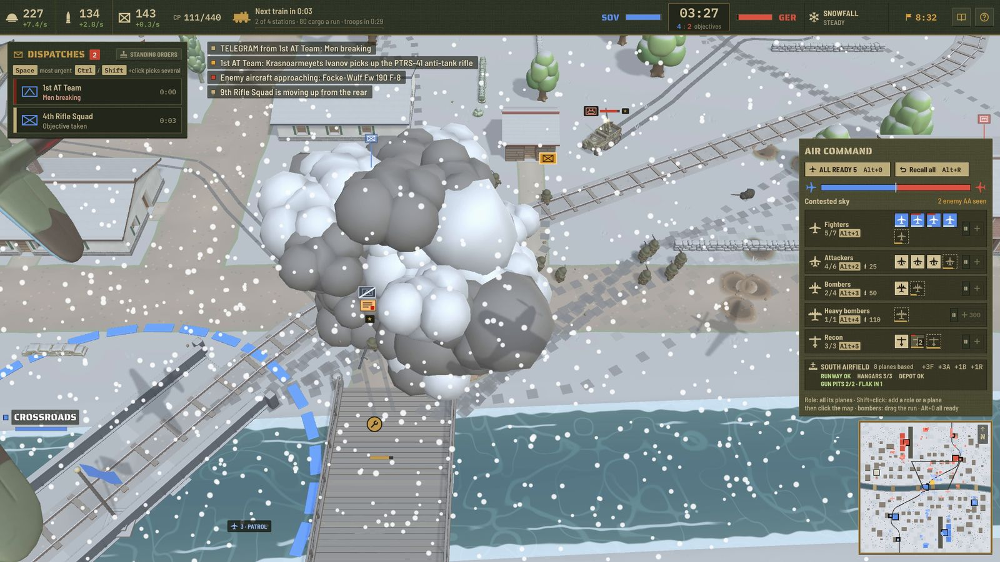

# fronts1944.com

The FRONTS 1944 website: a landing page, the roadmap and a devlog. Plain static files, no framework and no build server.
GitHub Pages (or Cloudflare Pages) serves the folder as it is.

| Path | What it is | Edited by hand? |
|---|---|---|
| `index.html` | the landing page | yes, except the blocks between `<!--TOP-->`, `<!--FOOT-->`, `<!--ROADMAP-TALLY-->` and `<!--DEVLOG-LATEST-->` markers |
| `roadmap/` | the roadmap, wrapped with the site's top bar | **no**: generated from the game repo |
| `devlog/` | the devlog pages | **no**: generated from `content/devlog/*.md` |
| `content/devlog/*.md` | the devlog posts | yes |
| `assets/` | styles, pictures, icons, the teaser | `site.css` and `chrome.css` yes; pictures come from `tools/make_media.py` |

## Everyday work

**Write a devlog post.** Add `content/devlog/YYYY-MM-DD-short-name.md`:

```markdown
---
title: The title of the post
date: 2026-12-01
image: assets/img/train-md.jpg
summary: One sentence for the list and for link previews.
---
Paragraphs, ## headings, - lists, **bold**, *italic*, [links](https://...) and a picture on its own line:


```

Then run the build and commit:

```powershell
python -I tools/build.py
```

**Update the roadmap.** Edit `C:\Playground\UP\RTS-merge\Docs\roadmap\fronts-roadmap.html` (the `STEPS` list) in the game repo,
then run `python -I tools/build.py` here. It copies the page and its `img/` folder in and refreshes the tally on the landing page.

**New screenshots or a new teaser.** Change the lists in `tools/make_media.py`, then `python -I tools/make_media.py`
(needs ffmpeg on PATH for the video; add `--no-video` to skip it).

**Preview.** `python -m http.server 8044` in this folder, then open http://localhost:8044.

## Going live (one-time steps, yours)

1. **Buy the domain** `fronts1944.com` at a registrar (Cloudflare Registrar sells at cost, about $10 a year).
2. **Create the GitHub repo** `fronts1944-site` (public; GitHub Pages is free for public repos) and push this folder:
   `git remote add origin https://github.com/<you>/fronts1944-site.git` then `git push -u origin main`.
3. **Turn on Pages:** repo **Settings > Pages > Source: Deploy from a branch, `main`, `/ (root)`**. The `CNAME` file already
   names `fronts1944.com`.
4. **Point the domain at GitHub** at the registrar's DNS:
   - four `A` records for `fronts1944.com`: `185.199.108.153`, `185.199.109.153`, `185.199.110.153`, `185.199.111.153`
   - one `CNAME` record: `www` → `<you>.github.io`
   Then in **Settings > Pages** wait for the DNS check and tick **Enforce HTTPS**.

## Still to do

- **Steam wishlist button.** When the store page exists, replace the two "Wishlist on Steam – coming soon" spans in
  `index.html` with links to `https://store.steampowered.com/app/<appid>/` and add it to the foot in `tools/build.py`.
- **Legal notice (impresszum).** Hungarian law expects the operator's name and contact details on a commercial site. Add a
  page once there is a sole-trader registration and a public contact address for the game (not a personal e-mail).
- **Fonts and privacy.** The pages load their three fonts from Google Fonts, which sends visitors' IP addresses to Google.
  EU courts have fined sites for that without consent; hosting the font files in `assets/fonts/` removes the issue.
- **A contact route** (e-mail just for the game, or the testers' Discord once it is live) in the foot.
